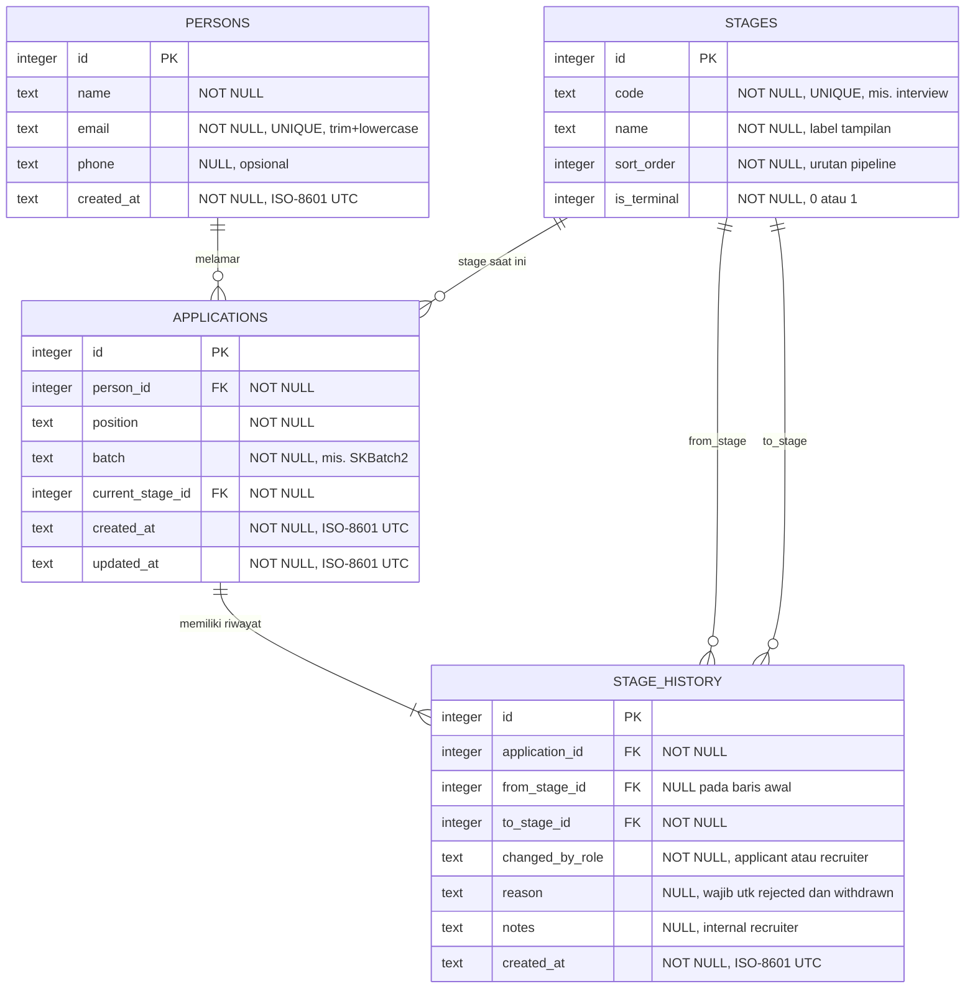
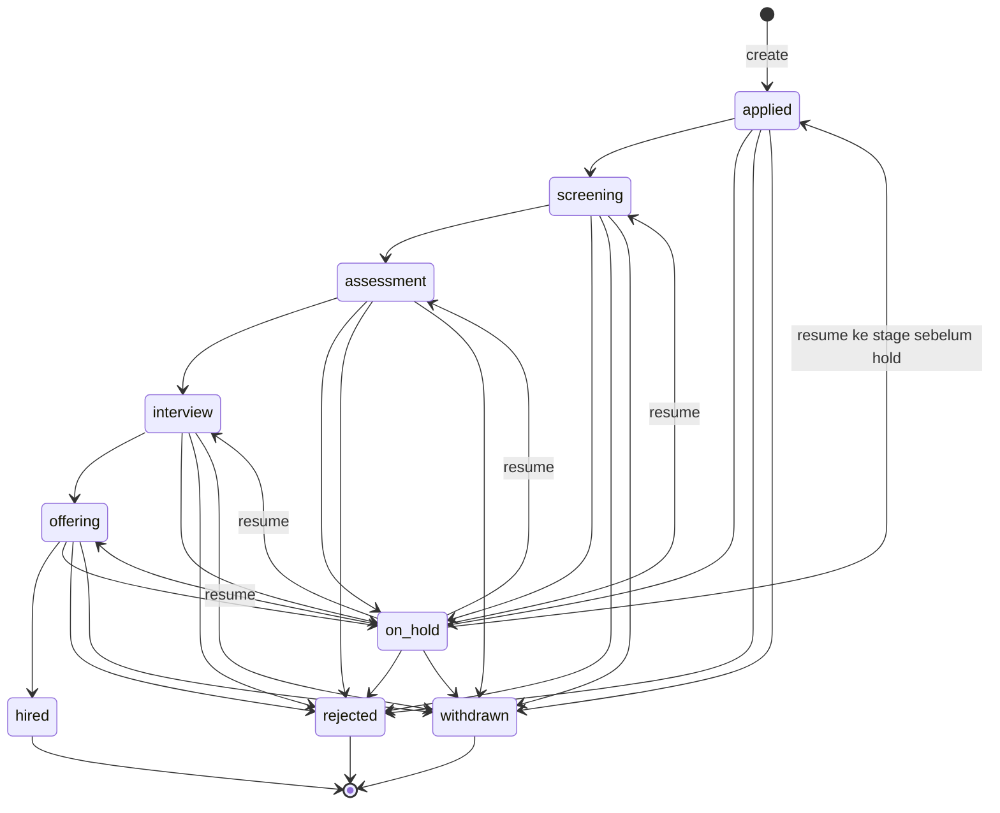

# ERD

Diagram ditulis dengan Mermaid. Tampil otomatis di GitHub, atau buka di <https://mermaid.live> (tempel isi blok `mermaid`), atau ekstensi "Markdown Preview Mermaid Support" di VS Code.

## Constraint dan index

- `persons.email`: `UNIQUE`. Nilai disimpan setelah trim + lowercase.
- `stages.code`: `UNIQUE`.
- `applications`: `UNIQUE(person_id, position, batch)`. Satu orang, satu lamaran per posisi per periode.
- `applications.current_stage_id`: index, karena filter `stage` di list.
- `stage_history.application_id`: index, untuk membaca timeline satu lamaran.
- Foreign key aktif (`PRAGMA foreign_keys = ON`, per koneksi). Semua foreign key memakai `ON DELETE RESTRICT`: data turunan, terutama `stage_history` sebagai jejak audit, tidak boleh hilang karena cascade.

## Daftar stage (seed)

| sort_order | code | is_terminal |
|---|---|---|
| 1 | applied | 0 |
| 2 | screening | 0 |
| 3 | assessment | 0 |
| 4 | interview | 0 |
| 5 | offering | 0 |
| 6 | hired | 1 |
| 7 | rejected | 1 |
| 8 | withdrawn | 1 |
| 9 | on_hold | 0 |

## Diagram transisi

Catatan: dari `on_hold`, resume hanya diizinkan ke satu stage, yaitu stage sebelum di-hold (dibaca dari `stage_history`). Diagram menampilkan semua kemungkinan, server hanya menerima satu.
